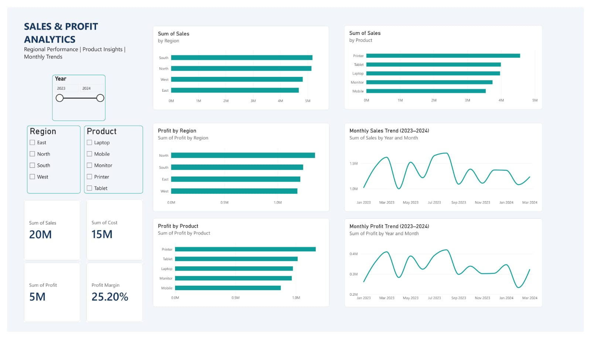

# Sales Analytics ETL Pipeline & Power BI Dashboard

An end-to-end sales analytics project using Python, Pandas, MySQL, SQL, and Power BI.

## Power BI Dashboard



## Project Overview

This project extracts sales data from Excel, validates and cleans it using Python, calculates profit-related fields, exports the cleaned data to CSV, and supports analysis through MySQL, SQL queries, and an interactive Power BI dashboard.

The project demonstrates data preparation, ETL development, database integration, automated testing, and business intelligence reporting.

## Business Problem

Raw sales data can contain duplicate records, invalid dates, and inconsistent numeric values. These issues can affect reporting and business decisions.

This project provides a repeatable process to validate and clean sales data, calculate profit, and explore sales performance by region, product, and month.

## Features

- Extract sales data from Excel.
- Validate required columns and numeric values.
- Remove exact duplicate records.
- Convert dates and remove records with invalid dates.
- Calculate Profit as Sales minus Cost.
- Derive Year and Month fields.
- Export cleaned data to CSV.
- Load data into MySQL without overwriting an existing table.
- Run SQL queries for sales and profit analysis.
- Test ETL transformations using pytest.
- Test MySQL connectivity using environment-based configuration.
- Explore results through an interactive Power BI dashboard.

## Project Architecture

```text
Raw Excel Data
      |
      v
Python ETL Pipeline
      |
      +--> Validate required columns and numeric values
      |
      +--> Remove exact duplicate records
      |
      +--> Clean dates
      |
      +--> Calculate Profit, Year and Month
      |
      v
Cleaned Data
      |
      +--> CSV Export
      |
      +--> MySQL Database
      |
      +--> SQL Analysis
      |
      v
Power BI Dashboard
```

## Technology Stack

| Area | Tools |
|---|---|
| Programming | Python |
| Data processing | Pandas, NumPy |
| Database | MySQL |
| Database connection | SQLAlchemy, PyMySQL |
| Data source | Microsoft Excel |
| Data export | CSV |
| Business intelligence | Power BI |
| Testing | pytest |
| Environment configuration | python-dotenv |

## Dataset and Transformation

The source Excel file contains 520 rows and 7 columns:

`Order_ID`, `Order_Date`, `Customer`, `Region`, `Product`, `Sales`, and `Cost`.

The ETL pipeline adds three derived columns:

- **Profit:** Sales minus Cost
- **Year:** Extracted from `Order_Date`
- **Month:** Extracted from `Order_Date`

The expected cleaned output contains 482 rows and 10 columns after removing exact duplicate records and rows with invalid dates.

These counts describe the supplied dataset; the output may differ if the source data changes.

## Project Structure

```text
Sales-Analytics-ETL-Project/
├── images/
│   └── dashboard.jpeg
├── etl_pipeline.py
├── test_etl_pipeline.py
├── test_db_connection.py
├── analysis_queries.sql
├── cleaning.ipynb
├── sales_raw_500.xlsx
├── sales_cleaned.csv
├── Sales_Analytics_Dashboard.pbix
├── requirements.txt
├── .gitignore
├── .env.example
├── LICENSE
└── README.md
```

The dashboard screenshot is included in the README using the relative path `dashboard.jpeg`. If the image is stored inside the `images` folder instead, update the Markdown path to `images/dashboard.jpeg`.

## Setup and Installation

### 1. Prerequisites

- Python installed
- MySQL Server, if you want to use database integration
- Power BI Desktop, if you want to open the dashboard

### 2. Install Dependencies

Create and activate a virtual environment if you haven't already.

On Windows PowerShell:

```powershell
python -m venv .venv
.\.venv\Scripts\Activate.ps1
python -m pip install -r requirements.txt
```

### 3. Configure MySQL

Create the database in MySQL:

```sql
CREATE DATABASE sales_analytics;
```

Create a local `.env` file based on `.env.example` and configure your own database settings:

```dotenv
DB_HOST=localhost
DB_PORT=3306
DB_NAME=sales_analytics
DB_USER=your_mysql_username
DB_PASSWORD=your_mysql_password
```

Replace the example values with your local MySQL credentials. Never commit `.env` or real passwords to GitHub.

The pipeline checks whether the destination table already exists and avoids replacing it. If the table exists, review it before deciding how to proceed.

### 4. Run the ETL Pipeline

From the project directory, run:

```powershell
python etl_pipeline.py
```

The script uses `sales_raw_500.xlsx` as its default input and writes the cleaned output to `sales_cleaned.csv`.

The script also attempts MySQL loading when run directly. Ensure your database settings are configured first.

### 5. Run the Automated Tests

```powershell
python -m pytest test_etl_pipeline.py -v
```

The tests cover duplicate and invalid-date handling, profit calculation, Year and Month creation, missing required columns, and invalid numeric values.

### 6. Test the Database Connection

After configuring `.env` and starting MySQL, run:

```powershell
python test_db_connection.py
```

## SQL Analysis

The `analysis_queries.sql` file contains queries for:

- Overall sales, cost, and profit.
- Regional sales and profit.
- Product-wise sales and profit.
- Monthly sales and profit trends.

These queries use the `sales_analytics` database and `sales_data` table.

## Power BI Dashboard Features

The dashboard supports sales and profitability analysis through:

- KPI cards for Sales, Cost, Profit, and Profit Margin.
- Sales and profit comparisons by region.
- Sales and profit comparisons by product.
- Monthly sales and profit trends.
- Year, region, and product slicers for filtering the report.

Open `Sales_Analytics_Dashboard.pbix` in Power BI Desktop to explore the interactive report.

## Key Skills Demonstrated

- Python ETL development
- Data cleaning and validation
- Pandas data manipulation
- SQL querying and aggregation
- MySQL integration
- Automated unit testing
- Database credential management
- Power BI dashboard development
- Data analysis and reporting

## Future Improvements

- Add more data-quality checks for missing identifiers and invalid sales or cost values.
- Improve pipeline status reporting and error handling.
- Add incremental database loading.
- Automate pipeline execution.
- Expand test coverage to include CSV export and database loading.
- Add more dashboard screenshots and sample business findings.

## Attribution

This project is adapted and extended from the original work by **Piyush Nirmal**.

Additional work in this version includes ETL validation, database overwrite protection, automated transformation tests, SQL analysis queries, database connection testing, and dashboard refinements.

The original MIT License and copyright notice are retained. See `LICENSE` for details.
